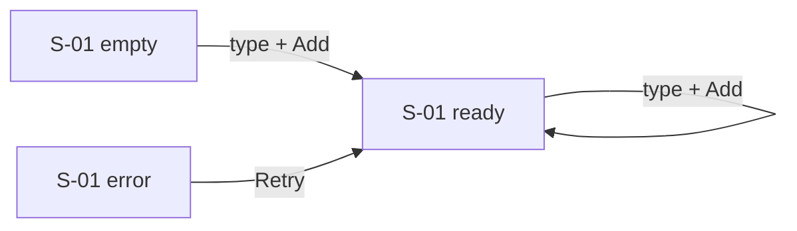

# Screens

## Index

| ID | Screen | Route | Features | Auth |
|---|---|---|---|---|
| S-01 | Task list | `/` | F-001, F-002 | public |

## S-01 Task list

sxl: F-001 · F-002

**Purpose**: see and add tasks in one place.

### Controls

| Control | Kind | Does | AC |
|---|---|---|---|
| Title input | text input | holds the new task title | F-002.AC1 |
| Add | primary button | adds the task | F-002.AC1, F-002.AC2 |
| Retry | button (error state) | reloads tasks | F-001.AC3 |

### States

| State | Trigger | What the user sees | Way out | AC |
|---|---|---|---|---|
| loading | first load ~700ms | 3 skeleton rows | — | F-001.AC1 |
| ready | ≥1 task | list newest first | — | F-001.AC1 |
| empty | 0 tasks | "All clear" + focus on input | type a title | F-001.AC2 |
| error | 5xx / network | "Couldn't load tasks" + Retry | Retry | F-001.AC3 |
| validation-error | Add with empty title | "Title is required" under input | type a title | F-002.AC2 |

## Flows

