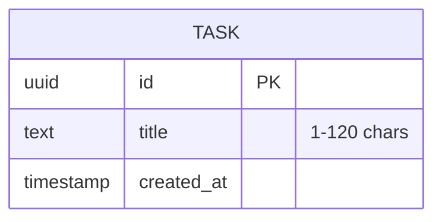

## Overview

sxl: F-001 · F-002

## Task

sxl: F-001.AC1 · F-002.AC1 · F-002.AC2

Something the member wants to remember to do.

| Attribute | Type | Null | Default | Rules |
|---|---|---|---|---|
| `id` | uuid | no | generated | |
| `title` | text | no | | trimmed, 1–120 chars (R-01) |
| `created_at` | timestamp | no | now | list order, newest first |

**Access**: single shared list, no accounts in v1.

## Hot paths

| Screen / query | Query | Index |
|---|---|---|
| S-01 list | all tasks by `created_at desc` | `task(created_at desc)` |

## Traceability

| Feature | Entities |
|---|---|
| F-001 | Task |
| F-002 | Task |
