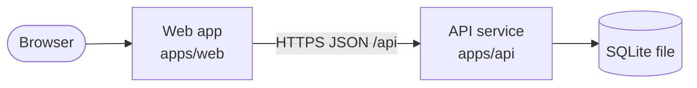
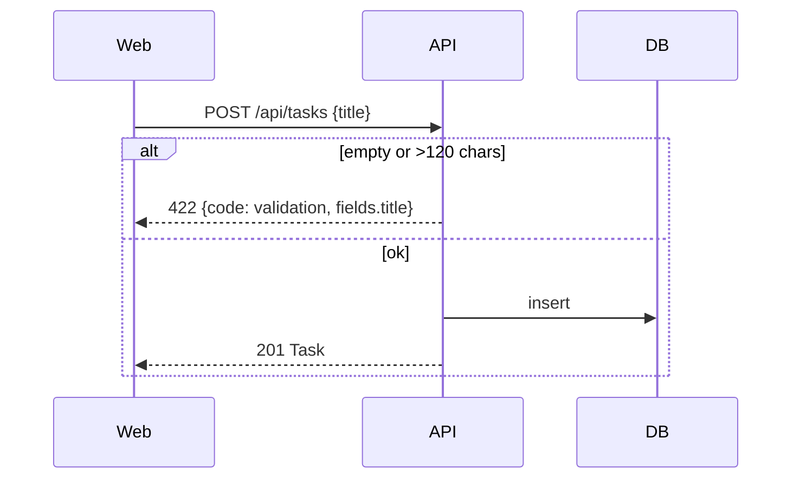

## Components

sxl: F-001 · F-002

| Component | Owns | Writes | Why it exists |
|---|---|---|---|
| Web app | UI, client validation | — | every feature |
| API service | rules (R-01), persistence | Task | every feature |
| SQLite | durable tasks | — | data model |

## Key flows

### Add a task

sxl: F-002.AC1 · F-002.AC2

## Decisions

### ADR-001 Node + Hono + node:sqlite
- **Context**: one small JSON API, team already writes TypeScript, CI must need no services.
- **Decision**: Hono on Node 22 with the built-in `node:sqlite`; tests run against a temp file.
- **Consequences**: no ORM; migrations are plain SQL run at startup.
