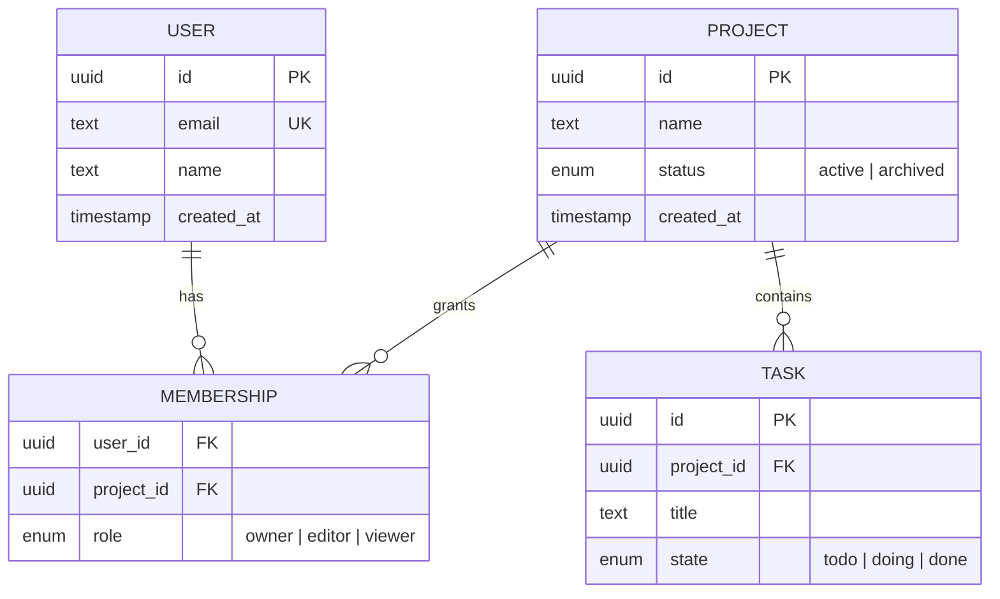
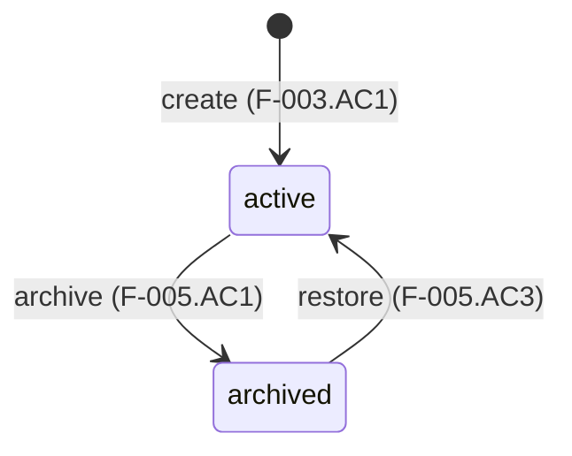

<!-- Generated by the sixloom `data` loom. Edit through a change record. -->

## Overview

sxl: F-001 · F-002 · F-003

## Project

sxl: F-002 · F-003.AC1 · F-003.AC2

A shared workspace that groups tasks for a team.

| Attribute | Type | Null | Default | Rules |
|---|---|---|---|---|
| `id` | uuid | no | generated | |
| `name` | text | no | | 1–80 chars, unique per owner (F-003.AC2) |
| `status` | enum | no | `active` | see lifecycle |
| `created_at` | timestamp | no | now | |

**Constraints**: a user owns at most 5 `active` projects (R-01), enforced in the service on create/unarchive.
**On delete**: soft delete via `archived`; hard delete only by retention job.
**Access**: members read; owner/editor write; only owner archives.

## Hot paths

| Screen / query | Query | Index |
|---|---|---|
| S-02 project list | projects by member, newest first | `membership(user_id)`, `project(created_at desc)` |

## Traceability

| Feature | Entities |
|---|---|
| F-002 | Project, Membership |
| F-003 | Project |

## Decisions

- **Soft delete for projects.** *Context*: F-005 needs restore. *Decision*: `status = archived`. *Consequence*: every list query filters on status.
