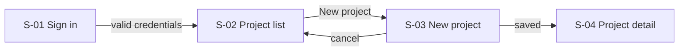

# Screens

<!-- Screen IDs are permanent: S-01, S-02 … Tests and preview routes use them. -->

## Index

| ID | Screen | Route | Features | Auth |
|---|---|---|---|---|
| S-01 | Sign in | `/sign-in` | F-001 | public |
| S-02 | Project list | `/projects` | F-002, F-003 | member |

## S-02 Project list

**Purpose**: <one line>
**Route**: `/projects`  ·  **Features**: F-002, F-003

### Controls

| Control | Kind | Does | AC |
|---|---|---|---|
| New project | primary button | opens S-03 | F-003.AC1 |
| Search | text input | filters list as you type (debounced) | F-002.AC2 |
| Project row | link | opens S-04 | F-002.AC1 |

### States

| State | Trigger | What the user sees | Way out |
|---|---|---|---|
| loading | first load, ~600ms | 6 skeleton rows, toolbar enabled | — |
| empty | 0 projects | illustration + "Create your first project" | New project |
| ready | ≥1 project | table, 20 per page | — |
| error | API 5xx / network | inline error card with message + Retry | Retry |
| no-permission | 403 | "Ask an admin for access" | Back |

## Flows

