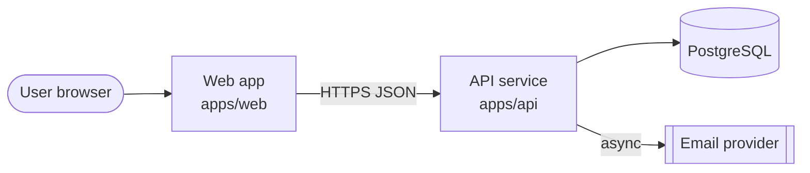
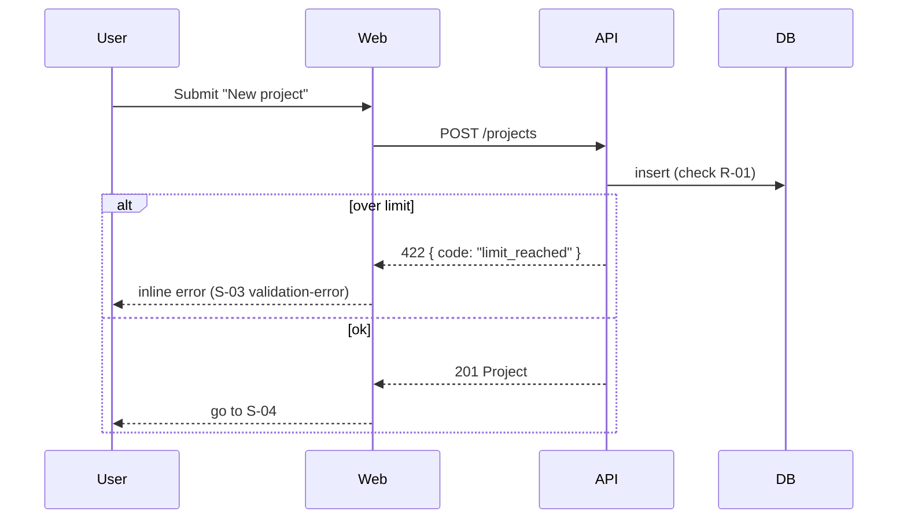

<!-- Generated by the sixloom `system` loom. Mermaid is the source; docs/diagrams/system.drawio is the editable view. -->

## Components

| Component | Owns | Writes | Why it exists |
|---|---|---|---|
| Web app | UI, client validation | — | every feature |
| API service | business rules, auth | Project, Task, Membership | every feature |
| PostgreSQL | durable state | — | data model |
| Email provider | delivery | — | F-007 invite by email |

## Key flows

### Create project

sxl: F-003.AC1 · F-003.AC2

## Decisions

### ADR-001 Backend language and framework
- **Context**: …
- **Options**: …
- **Decision**: …
- **Consequences**: …
